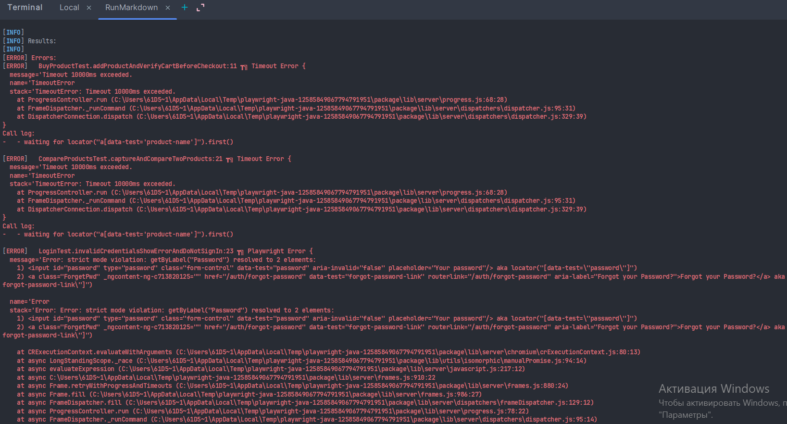
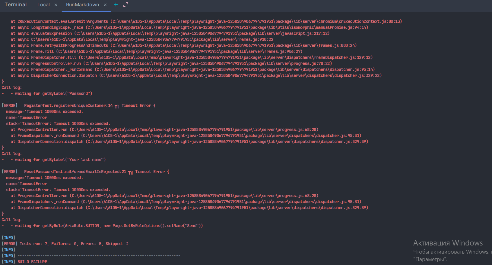

# AI results

ChatGPT gives me full implementation of the task in **zip** format.
Its solution didn't pass the tests:

**YOU CAN CHECK AI VERSION OF TASK IN FIRST COMMIT**

# Modifications

## Register new customer

In **RegisterPage.java** replaced text-based getByLabel locators with **getByTestId**.
The website uses specific data-test attributes for its form fields. 
Using getByTestId matches the requirements (no CSS/XPath) and makes the tests stable against layout changes.

Replaced .fill() with .selectOption() for the country field.
The country field is a standard HTML \<select> element. 
We cannot "type" text into a dropdown; we must select an option from it.

Updated field identifiers to exactly match the site's data-test attribute names (e.g., postal_code, house_number).
If a locator doesn't match the HTML, We can not find field and get timeout exception.

Also, postal code was selected correctly by country.

## Log in

In **LoginPage.java** replaced text-based getByLabel locators with **getByTestId**.
**getByLabel("Password")** caused a Strict Mode Violation because it matched both the password input field and the "Forgot your Password?" link. Using getByTestId is more stable, reliable.

Also provided concrete test credentials so the test runs directly without needing manual environment variable configuration in IntelliJ.

**There can be error in this task caused by `Account locked, too many failed attempts. Please contact the administrator.`**

## Buy a product

The **.first()**  has been added to **getByText(name)** to avoid potential “strict mode” errors when product names match.

In **ProductPage.java** replaced text-based locators with **getByTestId**.

Unnecessary methods were deleted.

## Compare two products

Text-based locators replaced with **getByTestId**.

Additional calls to isVisible() have been removed, 
since Playwright's built-in auto-waiting mechanism automatically waits for elements to appear and become clickable when .nth(1).click() is called.

## Reset a password

Text-based locators replaced with **getByTestId**.

A specific test email address has been specified (customer2@practicesoftwaretesting.com).
The test for a valid email address used environment variables (System.getenv(“E2E_USER_EMAIL”)) with a JUnit assumption (assumeTrue), 
which caused the test to be skipped (Aborted) if the variable was not set on the developer's computer.

The test texts have been made to match the actual behavior of the application interface exactly 
(“confirm” and “email is invalid”).
AI was looking for incorrect phrases ("reset" and "valid email")

Correct testId was placed to **page.getByTestId("forgot-password-submit")**.
The form submission button was being searched for based on its role and an incorrect name (setName(“Send”)), 
which caused a TimeoutError because the actual button on the website has a different identifier/text.

